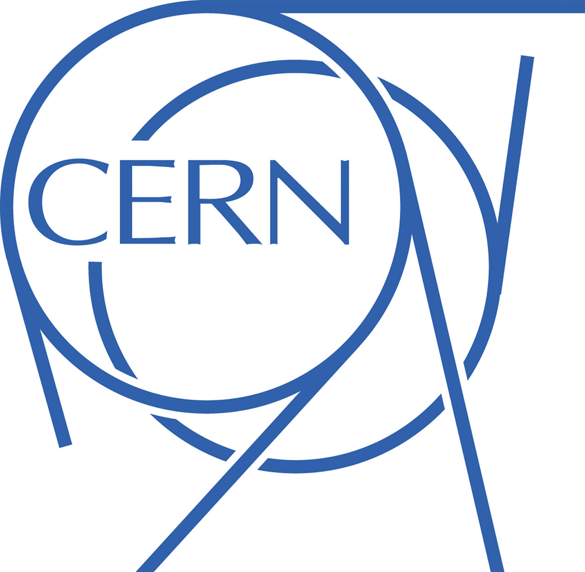
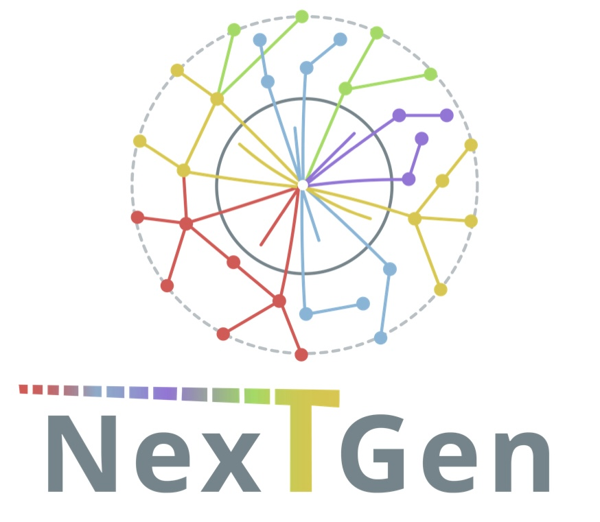

<span>
  
</span>
<span>
  
</span>
<span>
  
</span>
<span>
  
</span>

[](https://results.pre-commit.ci/latest/github/CMS-L1T-Jet-Tagging/TrainTagger/main)
[](https://gitlab.cern.ch/ml_l1/TrainTagger/-/commits/main)


# Training Jet Taggers for CMS Phase 2 L1 Trigger

Documentation for training a L1T Jet Tagging model for CMS Phase-2 L1 upgrades.

To train the jet tagger, there are multiple steps that one need to follow, from creating the raw datasets, preprocessing them, train the model, synthesize it, and make validation plots for different physics seeds. This README describes all the steps in a sequential manner.

The CI in this repository aims at building a pipeline that enables running all of these steps automatically. The CI artifacts are saved here: https://cms-l1t-jet-tagger.web.cern.ch/

**A summary menu of all the steps is listed below**:

[1. Produce Raw Training Datasets](#1-produce-raw-training-dataset)

[2. Prepare the data and train the model](#2-prepare-the-data-and-train-the-model)

[3. Physics Validation](#3-physics-validation)

[4. Convert and synthesize the model](#4-convert-and-synthesize-the-model)

[5. CMSSW emulation](#5-cmssw-emulation)

**Other topics**:

- [Conda environment notes](#conda-environment-notes)
- [Adding a new model](#adding-a-new-model)
- [Continuous Integration](#continuous-integration)
- [Related materials](#related-materials)

The commands below mirror the CI pipeline in [`CI/ml_pipeline.yml`](CI/ml_pipeline.yml), which is the reference for how the code is run. If a command here and the CI disagree, trust the CI.
Note that the instructions are assuming that you have access to the appropriate `eos` data spaces.
If you are not interested in reading lengthy documentation like me, below is a ultra-short version to get started on running the code (more details in each specific command is provided in each section above, futher help can be found by looking into each script)

# Quick start:
Run everything from the TrainTagger directory. `setup.sh` sets the CI defaults and the input paths (`$TRAIN_FILE`, `$MINBIAS_FILE`, ...).

Reading the input files over `/eos` is very slow. **The copy to /data needs about 60 GB of free disk space** (`All200.root` alone is 47 GB); check with `df -h .`. Without enough space, skip the copy and the scripts fall back to read from EOS. The quick test reads only a small part of the files, so it can also skip the copy.


`$WORK_MOUNT` (from `setup.sh`) is the mount that holds your checkout: by default the top-level directory of the current path, e.g. `/shared` on NGT. Set it before sourcing `setup.sh` if that is wrong. `setup_cmssw.sh` exits with 0 even when `cmsRun` fails, so check that the `jetTuple_*.root` file is larger than a few hundred bytes.

**Remark**:
The quick test on 2% of the data only checks that the chain runs; its plots are not physically meaningful. It may happen that some ROC curves are not plotted due to low statistics.

```bash
# Copy the inputs to data/ once (~60 GB, see above)
mkdir -p data
for f in $TRAIN ${SIGNAL}.root $MINBIAS $VBFHTAUTAU; do
    cp -n $EOS_DATA_DIR$f data/
done
cp -n $BBBB_EOS_DIR$BBBB $BBTT_EOS_DIR$BBTT data/
```

```bash
# Activate setup
conda activate tagger
source setup.sh
```

```bash
# Prepare the data
export RATIO=0.02 # (for quick test or 1.0 for full test)
python tagger/data/make_data.py -i $TRAIN_FILE -sig $SIGNAL -r $RATIO

# set model: any config in tagger/model/configs
# e.g. baseline (= Deepset Model)
export Model=baseline
CFG=tagger/model/configs/$Model.yaml
OUT=output/$Model

# Train with 50% of data, then make the basic plots
python tagger/train/train.py -p 50 -y $CFG -o $OUT
python tagger/train/train.py --plot-basic -sig $SIGNAL -o $OUT

# Physics validation, bbbb only (more in section 3)
python tagger/plot/bbbb.py --deriveWPs -m $OUT
python tagger/plot/bbbb.py --eff -m $OUT
```

```bash
# Convert to HLS (the env has the hls4ml fork, section 4)
python tagger/firmware/hls4ml_convert.py -m $OUT -o $OUT/firmware

# CMSSW emulator (section 5), in an el8 container
kinit <user>@CERN.CH
/cvmfs/cms.cern.ch/common/cmssw-el8 -B /eos -B $WORK_MOUNT

# --- inside container, from TrainTagger:
source setup.sh
source /cvmfs/cms.cern.ch/cmsset_default.sh
./CI/setup_cmssw.sh -run $CMSSW_VERSION $CMSSW_L1CT $FASTPUPPI_VERSION
exit

# --- back in original shell (with activated setup):
python tagger/plot/makeEmulationPlot.py -r True -i $JETTUPLE -m $OUT
```

# 0. Setup
Set up the conda environment and paths:

```bash
# Create the environment from the yaml file (~10min)
conda env create -f environment.yml

# Activate the environment
conda activate tagger

# Add the repo to PYTHONPATH and set the default variables (Model, TRAIN, SIGNAL, ...)
source setup.sh
```

`setup.sh` sets the same variables, with the same default values, as [`CI/ml_pipeline.yml`](CI/ml_pipeline.yml). If you change the defaults in the CI, update `setup.sh` too.

`setup.sh` also sets the paths of the input files (`$TRAIN_FILE`, `$SIGNAL_FILE`, `$MINBIAS_FILE`, `$BBBB_FILE`, `$BBTT_FILE`, `$VBFHTAUTAU_FILE`). Each one points to the copy in `data/` (`$DATA_DIR`) if it exists, otherwise to the file on EOS. To use other samples, change `EOS_DATA_DIR` or the file names and source `setup.sh` again.

Reading over `/eos` works but is very slow, and the evaluate scripts reread MinBias on every run. So copy the files to `data/` once.
**This needs about 60 GB of free disk space** (`All200.root` alone is 47 GB); check with `df -h .`. Without enough space, skip the copy and the scripts read from EOS.

```bash
mkdir -p data
for f in $TRAIN ${SIGNAL}.root $MINBIAS $VBFHTAUTAU; do
    cp -n $EOS_DATA_DIR$f data/
done
cp -n $BBBB_EOS_DIR$BBBB $BBTT_EOS_DIR$BBTT data/
source setup.sh   # now points $TRAIN_FILE etc. to data/
```

# 1. Raw training dataset production

**Nothing to do here.** This section explains where the input files come from. They are already produced and stored on EOS, and `setup.sh` points to them (`$EOS_DATA_DIR`). Start with [section 2](#2-prepare-the-data-and-train-the-model).

The input files were made in two steps with the [FastPUPPI](https://github.com/CMS-L1T-Jet-Tagging/FastPUPPI) repo. The jobs were submitted with the [submission](https://github.com/CMS-L1T-Jet-Tagging/submission) repo.

1. **RAW samples → slimmed inputs.** The `runInputs_X_X.py` scripts in FastPUPPI prune the RAW samples and write `inputs*.root` files. The current samples were made from:

   ```
   /eos/cms/store/cmst3/group/l1tr/FastPUPPI/17_0_X/fpinputs_170X/v0.1/
   ```

   Section 5 runs the CMSSW emulator on these same files.

2. **Slimmed inputs → jet ntuples.** The FastPUPPI ntuplizer (`runPerformanceNTuple.py`, which calls `jetNTuplizer.cc`) turns the inputs into jet ntuples, one file per process. Section 2 starts from these files, in `$EOS_DATA_DIR`:

   ```
   /eos/cms/store/cmst3/group/l1tr/sewuchte/l1teg/fp_jettuples_240926_170X_v0.1_full/
   ```

You only need to repeat these steps to make new samples, e.g. for a new CMSSW release or other ntuple contents. Then point `EOS_DATA_DIR` in `setup.sh` (and in `CI/ml_pipeline.yml`) to the new ntuples.
Note that to submit jobs as part of this setup, you need the [submission](https://github.com/CMS-L1T-Jet-Tagging/submission/tree/dev/14_0_X-leptons) repo as well.

# 2. Prepare the data and train the model

After creating the training ntuples, in our setup, they will then be shuffled and concatenate (`hadd`) into a big file, such as this one (`${EOS_DATA_DIR}/${TRAIN}`):

```
/eos/cms/store/cmst3/group/l1tr/sewuchte/l1teg/fp_jettuples_240926_170X_v0.1_full/All200.root
```


Prepare the data with `make_data.py`, which looks for `${SIGNAL}.root` in the same directory as the training file:

```bash
python tagger/data/make_data.py -i $TRAIN_FILE --tree $NTUPLE_TREE -sig $SIGNAL
```

This writes `training_data/` and `signal_process_data/` (it asks before removing existing ones). Use `-s` to change the `uproot.iterate` step size and `-r` to process only a fraction of the input file. To redo only the signal samples, answer `n` for `training_data/` and `y` for the signal.

Train the model and make the basic plots:

```bash
python tagger/train/train.py -p 50 -y tagger/model/configs/$Model.yaml -o output/$Model
python tagger/train/train.py --plot-basic -sig $SIGNAL -o output/$Model
```

- `-y` selects the model config from `tagger/model/configs`; hyperparameters live there.
- `-o` is the output directory for the model, the test data and the plots.
- `-p` is the percentage of the processed data to train on (the CI uses 50).
- `-sig` adds signal-specific ROC curves; this needs `signal_process_data/`.

Training plots land in `output/$Model/plots/training`.

# 3. Physics Validation

Various physics validation plots can be made using the `tagger/plot` modules. The plots are divided into different final states, such as `bbbb.py`. To use the script, you need to derive the working points on MinBias before evaluating the background rate/efficiency. The -m points the plotting script at the model to load and use for evaluating

```
python tagger/plot/bbbb.py --deriveWPs -n <number of samples to use, usually ~1M> -m output/baseline
```

then, evaluate the efficiency using:

```
python tagger/plot/bbbb.py --eff -n <number of samples to use, usually ~500k> -m output/baseline
```

### Examples for different decays
```bash
# pT weights
python tagger/plot/pt_weights.py -m output/$Model

# bb tautau
python tagger/plot/bbtt.py --deriveRate --minbias $MINBIAS_FILE -n 650000 --tree $NTUPLE_TREE -m output/$Model
python tagger/plot/bbtt.py --deriveWPs --minbias $MINBIAS_FILE --signal $BBTT_FILE -n 650000 --tree $NTUPLE_TREE -m output/$Model
python tagger/plot/bbtt.py --eff -s $BBTT_FILE -n 500000 --tree $NTUPLE_TREE -m output/$Model

# VBF tautau
python tagger/plot/diTaus.py --deriveWPs --minbias $MINBIAS_FILE -n 650000 --tree $NTUPLE_TREE -m output/$Model
python tagger/plot/diTaus.py --BkgRate --minbias $MINBIAS_FILE -n 500000 --tree $NTUPLE_TREE -m output/$Model
python tagger/plot/diTaus.py --eff --vbf_sample $VBFHTAUTAU_FILE -n 500000 --tree $NTUPLE_TREE -m output/$Model

# Topology tautau
python tagger/plot/diTaus_topo.py --deriveWPs --minbias $MINBIAS_FILE -n 1000000 --tree $NTUPLE_TREE -m output/$Model
python tagger/plot/diTaus_topo.py --BkgRate --minbias $MINBIAS_FILE -n 1000000 --tree $NTUPLE_TREE -m output/$Model
python tagger/plot/diTaus_topo.py --eff --vbf_sample $VBFHTAUTAU_FILE -n 1000000 --tree $NTUPLE_TREE -m output/$Model

# bbbb
python tagger/plot/bbbb.py --deriveWPs --minbias $MINBIAS_FILE -n 650000 --tree $NTUPLE_TREE -m output/$Model
python tagger/plot/bbbb.py --eff -s $BBBB_FILE --minbias $MINBIAS_FILE -n 500000 --tree $NTUPLE_TREE -m output/$Model

# Single tau
python tagger/plot/singleTau.py --deriveWPs --minbias $MINBIAS_FILE -n 1000000 --tree $NTUPLE_TREE -m output/$Model
python tagger/plot/singleTau.py --eff --vbf_sample $VBFHTAUTAU_FILE -n 1000000 --tree $NTUPLE_TREE -m output/$Model
```

The plots land in `output/$Model/plots/physics`.

# 4. Convert and synthesize the model

Convert the model `-m` to an HLS project in `-o`. This is Python only and needs no Vivado:

```bash
python tagger/firmware/hls4ml_convert.py -m output/$Model -o output/$Model/firmware
```

Then run the Vitis HLS build and Vivado synthesis. If `vitis_hls` is not on your `PATH`, source `/opt/Xilinx/Vitis_HLS/<version>/settings64.sh` first. Vitis HLS 2024.1 also works; it prints `ERROR: [HLS 200-101] config_array_partition: Unknown option '-maximum_size'`, which is harmless because hls4ml wraps that call in `catch`.

```bash
cd output/$Model/firmware/L1TSC4NGJetModel
vitis_hls -f build_prj.tcl
vivado -mode batch -source vivado_synth.tcl
cd -
```

# 5. CMSSW emulation

The CI builds `${CMSSW_VERSION}` (currently `CMSSW_17_0_0_pre2`) with the `${CMSSW_L1CT}` branch, puts the hls4ml project from step 4 into the [`L1TSC4NGJetModel`](https://github.com/cms-hls4ml/L1TSC4NGJetModel) emulator wrapper, and runs the FastPUPPI jet ntuplizer.

Before you start:

- The release is built for `el8`. On an `el9` machine, run inside the `cmssw-el8` container, otherwise git and curl from CVMFS fail with `libssl.so.1.1: cannot open shared object file`.
- Bind the file system that holds your TrainTagger checkout into the container (`-B $WORK_MOUNT`, e.g. `/shared` on NGT), not only `/eos`. Otherwise `cmsenv` and `scram` fail with `SCRAM fatal: Unable to locate the top of local release`. The emulator step of `build_cmssw.sh` then writes no `perfNano.root` files.
- `git cms-init` needs your GitHub user name: `git config --global user.github <your github username>`.
- `cmsRun` reads its input from `/eos/cms` over xrootd, even though the path is written as `file:/eos/...`. You need a valid Kerberos ticket (`kinit <user>@CERN.CH`), otherwise it fails with `[3010] Unable to give access - user access restricted`.

```bash
kinit <user>@CERN.CH
source setup.sh   # sets WORK_MOUNT, the mount that holds your checkout
/cvmfs/cms.cern.ch/common/cmssw-el8 -B /eos -B $WORK_MOUNT
# inside the container, from the TrainTagger directory:
source setup.sh   # sets CMSSW_VERSION, CMSSW_L1CT, FASTPUPPI_VERSION, CMSSW_EMULATOR_WRAPPER, EMULATION_WRAPPER_VERSION
source /cvmfs/cms.cern.ch/cmsset_default.sh
./CI/setup_cmssw.sh -run $CMSSW_VERSION $CMSSW_L1CT $FASTPUPPI_VERSION
```

`setup.sh` sets `EMULATION_WRAPPER_VERSION=v1_0_2` (baseline). For `weightedAverageSimple`, run `export EMULATION_WRAPPER_VERSION=v2_0_0` before sourcing `setup.sh`.

The wrapper versions available on its `main` branch are `v1_0_2` (baseline) and `v2_0_0` (weightedAverageSimple). `setup_cmssw.sh` exits with 0 even when `cmsRun` fails, so check that `$JETTUPLE` is larger than a few hundred bytes.

Compare the TensorFlow, hls4ml and CMSSW emulator outputs (job `emulation-evaluate`), and profile the hls4ml model layer by layer (job `profile`, needs `pip install hls4ml[profiling]`):

```bash
# $JETTUPLE (from setup.sh) is the emulator output, read in place
python tagger/plot/makeEmulationPlot.py -r True -i $JETTUPLE -m output/$Model
python tagger/firmware/hls4ml_profile.py -r True -i $JETTUPLE -m output/$Model -of output/$Model/firmware -o output/$Model/plots/profile
```

The `run_processes` job runs the emulator on TT, VBFHToBB, VBFHToCC, MinBias and QCD samples and writes `<PROCESS>_perfNano.root` to `${EOS_STORAGE_DIR}/${EOS_STORAGE_PROCSDIR}`.

To run it locally, note that inside the `cmssw-el8` container listing `/eos/cms/...` fails with `Permission denied`, even with a valid Kerberos ticket. `prun.sh` then finds no input files and `cmsSplit.pl` stops with `Illegal division by zero`. Reading the files still works, because `cmsRun` opens them over xrootd. So create symlinks to the input files **outside** the container, and point `prun.sh` at them with `L1TPF_LOCAL_INPUT_DIR`:

```bash
# outside the container, from the TrainTagger directory
SRC=/eos/cms/store/cmst3/group/l1tr/FastPUPPI/17_0_X/fpinputs_170X/v0.1
for P in TT_PU200 VBFHToBB_PU200 VBFHToCC_PU200 MinBias_PU200 QCD_Pt15To3000_PU200; do
  mkdir -p localinputs/v0.1/$P
  for f in $(ls $SRC/$P/inputs140X_*root | head -2); do ln -sf $f localinputs/v0.1/$P/; done   # 2 files per process; drop "| head -2" for the full sample
done
```

The full samples are large (TT 60 files / 247 GB, MinBias 1148 files / 1.4 TB), so start with a few files.

Then, inside the container, run each process, merge its outputs and copy them to an output directory (this is what `CI/build_cmssw.sh` does after compiling):

`setup.sh` sets `L1TPF_LOCAL_INPUT_DIR=$PWD/localinputs` and `OUTPATH=$PWD/FPOutput`.

```bash
mkdir -p $OUTPATH
cd $CMSSW_VERSION/src/FastPUPPI/NtupleProducer/python
cmsenv
# point the producer at your model (L1TSC4NGJetModel_test); do this once, build_cmssw.sh does the same
grep -q L1TSC4NGJetModel_test runPerformanceNTuple.py || echo $'\nprocess.l1tSC4NGJetProducer.l1tSC4NGJetModelPath = cms.string(os.environ["CMSSW_BASE"]+"/src/L1TSC4NGJetModel/L1TSC4NGJetModel_test/L1TSC4NGJetModel_test")' >> runPerformanceNTuple.py
for P in TT_PU200 VBFHToBB_PU200 VBFHToCC_PU200 MinBias_PU200 QCD_Pt15To3000_PU200; do
  ./scripts/prun.sh runPerformanceNTuple.py --170X_v1 $P '' --nomerge 2>&1 | tee prun_$P.log   # must print "Will use local directory ..."
  (cd $P && hadd -f perfNano.root perfNano_${P}_job*.root && cp perfNano.root $OUTPATH/${P}_perfNano.root)
done
python3 scripts/makeJecs.py QCD_Pt15To3000_PU200/perfNano.root -A -o jecs.root
cp jecs.root $OUTPATH/
cd -
```

The plotting scripts need `jecs.root` and the `<PROCESS>_perfNano.root` files in the same directory. The `emulation_regression` job then makes regression plots from those files (locally, use `-i FPOutput`):

```bash
python tagger/plot/emulation_regression/plot_basic.py  -m output/$Model -i <dir with perfNano files>
python tagger/plot/emulation_regression/plot_masses.py -m output/$Model -i <dir with perfNano files>
python tagger/plot/emulation_regression/plot_turnon.py -m output/$Model -i <dir with perfNano files>
```

------
## Conda Environment Notes

To create the environment (once) from the TrainTagger directory, then activate it:

```
conda env create -f environment.yml
conda activate tagger
```

This also installs the `jet_tagger_hls4ml_update` hls4ml fork. Check with `conda env list` that `tagger` exists. If it already exists, `conda env create` fails; update it instead (see below).

To deactivate the environment:

```
conda deactivate
```

If you make any update for the environment, please edit the `environment.yml` file and run:

```
conda env update --file environment.yml  --prune
```

Reference on conda environment here: https://docs.conda.io/projects/conda/en/latest/user-guide/tasks/manage-environments.html


# Adding a new model
To add a new model class to the repo there are a number of steps needed:
First create a file MyModel.py in the tagger/model directory
This python script must contain a uniquely named model class that inherits from JetTagModel and is registered with the model factory:
```
@JetModelFactory.register('MyModel')
class MyModel(JetTagModel):
    """MyModel class

    Args:
        JetTagModel (_type_): Base class of a JetTagModel
    """
```

This `JetModelFactory.register('MyModel')` allows you to generate your model class directly from the yaml config.

The rest of the MyModel.py is up to you but you must include the following methods with the following arguments:
```
build_model(input_shape,output_shape)
# Shape of the input and output of the model, derived from the particle_features_train.shape[1:]  and y_train.shape[1:] (avoiding the batch size dimension)
compile_model(num_samples)
# Number of samples in the training data (for scheduling purposes)
fit( particle_features_train, y_train, pt_target_train, sample_weight)
# Each passed as a numpy array
@JetTagModel.save_decorator
save(out_dir)
# The save decorator is required.
@JetTagModel.load_decorator
load(out_dir)
# The load decorator is required.
```
OPTIONAL if you want to run firmware synthesis
```
firmware_convert(firmware_dir, build)
# where to save the firmware and whether or not to run the full hls4ml synthesis (needs a vitis install)
```


Secondly, add your model to the `tagger/model/__init__.py` as `from tagger.model.MyModel import MyModel`

Finally, add your config yaml to `tagger/model/configs`

The config must follow in style to the others present and contains your model hyperparameters. The hyperparameters are automatically loaded when the model is created either from the original yaml or from a saved model folder.
They are accessed in your model class with, for example, `self.model_config['name']`. The internal hyperparameters in each dictionary are for you to decide and access when building and compiling your model. Below is the minimum requirements for your yaml config:
```
model: MyModel #! This must be the same as the name you registered you model with in the JetModelFactory.register
run_config :
  verbose : 2
  debug : True

model_config :
  name : baseline

quantization_config:

training_config :
  weight_method: "onlyclass"
  validation_split : 0.1
```
OPTIONAL if you want to run firmware synthesis
```
firmware_config:
  input_precision: 'ap_fixed<24,12,AP_RND,AP_SAT>'
  class_precision: 'ap_ufixed<24,12,AP_RND,AP_SAT>'
  reg_precision: 'ap_fixed<16,6,AP_RND,AP_SAT>'

  clock_period : 2.5
  fpga_part : 'xcvu13p-flga2577-2-e'

  project_name: 'MyModel_test'
```

To train your new model just specify the new yaml when training e.g.

```
python tagger/train/train.py -y tagger/model/configs/mymodel.yaml -o output/mymodel
```

Your yaml file will be validated in the pre-commit-hooks. If your config adds extra parameters that are necessary for your model variant to run add these variables in the tagger/model/configs/scheme.py file with a new elif path for your specific model type.

# Continuous Integration

All branches of this repo have a continuous integration (CI) pipeline associated with them. These are hosted on a [gitlab](https://gitlab.cern.ch/ml_l1/TrainTagger) mirror. Contact cebrown@cern.ch for access.

Relevant variables for pipelines are found in ```.gitlab-ci.yml``` and are set as environment variables within the pipeline.
[`.gitlab-ci.yml`](.gitlab-ci.yml) defines one child pipeline per model (currently `DeepSet:baseline_5param_extended_trk` and `WeightedAverageSimple:weightedAverageSimple_5param_extended_trk`). Each child runs [`CI/ml_pipeline.yml`](CI/ml_pipeline.yml), which holds the default values of all variables. `.gitlab-ci.yml` overrides only the ones that change per model, such as `${Name}`, `${Model}` and `${EMULATION_WRAPPER_VERSION}`. The variables are set as environment variables, so e.g. `${Name}` expands to `baseline_5param_extended_trk`. The CI steps are essentially bash scripts.

All artefacts are uploaded to [this](https://cms-l1t-jet-tagger.web.cern.ch/TrainTagger/) website, with the structure `branches/my-branch/name/pipeline/plots|model|firmware`.

The CI will carry out dataset creation, training, evaluation, model synthesis, emulation, and uploading of all artefacts to a website for viewing. The stages are as follows, with some additional notes about each stage.

- **data**: creates the training data from `${EOS_DATA_DIR}/${TRAIN}` and `${SIGNAL}`, and saves `training_data_${Inputs}.tgz` and `signal_process_data.tgz` to `${EOS_STORAGE_DIR}/${EOS_STORAGE_DATADIR}`. It only appears when `tagger/data` changes and must then be triggered manually. Run it once on each new branch.
- **train**: runs [`CI/run_training.sh`](CI/run_training.sh), which trains on 50% of the data and makes the basic plots, including signal-specific ROC curves for `${SIGNAL}`. There is also the option of doing signal specific ROC curves. The signal for this is specified by the `${SIGNAL}` CI variable. These output plots are found in the `plots/training` website area.

  If you are not wanting to train the model and just look at plotting and firmware developments there is an option to run this training step to just produce the basic plots and to run the entire rest of the pipeline on the current in production CMSSW model. This is controlled by the ```${RERUN_ON_TAG}``` variable, set it to ```'True'``` if you want to run on the ```${TAG}``` model. The output of the pipeline will no longer be in a seperate branch area of the website and will instead be uploaded [here](https://cms-l1t-jet-tagger.web.cern.ch/TrainTagger/tags/v0.0.0/test/).

- **evaluate**: runs physics plotting including pT weight plots and physics performance for bb $\tau \tau$, VBF $\tau \tau$, topology $\tau \tau$, bbbb and single $\tau$.
- **hls4ml**: runs the hls4ml conversion, this is a python only (no vivado) building of the project.
Runs if `${RUN_SYNTHESIS}` is `'True'`.

- **synth**: runs the Vitis HLS build and Vivado synthesis (Vivado 2023.2). Runs if `${RUN_SYNTHESIS}` is `'True'`.
- **emulate**: runs the CMSSW emulation of the model using the output of the hls4ml build project step. This step uses the ```${CMSSW_VERSION}``` and ```${CMSSW_L1CT}``` fork:branch of CMSSW. It will insert the project that the previous step makes within the ```${CMSSW_EMULATOR_WRAPPER}``` If you change the model architecture or the model input and output quantisation you will need to make a new CMSSW emulator wrapper and potentially a new CMSSW branch for your model to pass the CI.
This and all later emulation stages need both `${RUN_EMULATION}` and `${RUN_SYNTHESIS}` set to `'True'`.
- **emulation-evaluate**: compares the TensorFlow, hls4ml and CMSSW emulator models on a test set of events.
- **profile**: layer-by-layer evaluation of the hls4ml model to find where precision is lost. It also prints the model's resource usage.
- **run_processes**: runs the CMSSW emulator on TT, VBFHToBB, VBFHToCC, MinBias and QCD (in parallel). It stores the `perfNano.root` files and the QCD JECs in `${EOS_STORAGE_DIR}/${EOS_STORAGE_PROCSDIR}`.
- **emulation_regression**: regression, mass and turn-on plots from the `run_processes` output.
- **upload_new_model** (`${RERUN_ON_TAG}` = `'False'`) and **upload_tagged_model** (`${RERUN_ON_TAG}` = `'True'`): upload the CI artefacts to the website. If you add new artefact folders, adapt [`CI/upload_new_model.sh`](CI/upload_new_model.sh) to include them.
- **test**: `pylint` and GitLab code quality reports.


## Related Materials

Related talks and materials to the project can be found here, they are ordered chronologically.

* [Level-1 Phase-2 Jet Tagging, 9 Jul 2024, Experience in jet tagger firmware integration](https://indico.cern.ch/event/1435130/)
* [Tau-Jets-MET, 7 May 2024, Jet tagging @ Phase-2 correlator layer](https://indico.cern.ch/event/1413293/#28-phase-2-jet-tagging)
