# Plotting

Plots are made in two steps. `python -m tagger.eval` computes the numbers (the variables of
[variables.md](variables.md)) and writes them to `output/<model>/eval/<collection>.json` and `.npz`.
`python -m tagger.plot` only reads those results and draws them. A plot never loads a model or a sample.

```
python -m tagger.eval -m output/baseline -c jetClassifier      # compute
python -m tagger.plot -m output/baseline -c jetClassifier      # draw, into output/baseline/plots/
```

| Option | Meaning |
| --- | --- |
| `-m` | Model folder. Repeat it to overlay several models in one plot. |
| `-l` | Legend label per `-m` (default: the folder name). |
| `-c` | Plot collection, repeatable. |
| `-o` | Plot folder (default: `<first model>/plots`). |
| `--only TEXT` | Draw only the plots whose path contains `TEXT`. |
| `--list` | List the plot collections, or with `-m` and `-c` the plot names. |

If a result is missing, the error message prints the eval command that computes it.

## How it fits together

```
eval collection ──> results (json/npz) ──> plot collection ──> PlotSpecs ──> plotter ──> pdf/png
 jetClassifier       output/m/eval/         jetClassifier       one per       curve_overlay
                                            (reads=[...])       figure        histogram, ...
```

- A **plot collection** is a function that returns a list of `PlotSpec`s. It names the eval
  collections it reads, and it gets the config and the model's classes from the stored results, so it
  draws exactly what the eval run computed.
- A **`PlotSpec`** describes one figure: its file name, the plotter that draws it, the `Series` it
  shows, and the axis options. No drawing code.
- A **plotter** is a generic drawing function in `tagger/plot/plotters.py` that turns a `PlotSpec`
  into a figure. Many specs share one plotter.

The plot collections are in `tagger/plot/specs/`, one module per topic (`jet_classifier.py`, `jet_pt.py`,
`train.py`, `seeds_tau.py`, `seeds_hh.py`, `emulation.py`). Every module there
is loaded automatically. In each module every plot is a function that returns its `PlotSpec` (its
docstring names the file), and the collection at the end of the module only lists the plots.

### PlotSpec and Series

```python
PlotSpec(name, plotter, series, options)
Series(expr, label="", x="x", y="y", yerr=None, style={})
```

| Field | Meaning |
| --- | --- |
| `PlotSpec.name` | File name without extension, relative to the plot folder, e.g. `"training/pt_hist"`. |
| `PlotSpec.plotter` | Name of the plotter, e.g. `"curve_overlay"`. |
| `PlotSpec.series` | List of `Series`. |
| `PlotSpec.options` | Axis options of the plotter (`xlabel`, `ylabel`, `logy`, `xlim`, `legend`, ...); see the plotter's docstring. |
| `Series.expr` | The result to draw: a variable expression, exactly as computed, e.g. `"roc(b, light)"`. |
| `Series.label` | Legend label. |
| `Series.x`, `Series.y`, `Series.yerr` | Which fields of a curve result go on the axes and the error bars. |
| `Series.style` | Passed to matplotlib (`color`, `linestyle`, `linewidth`, ...). |

**Labels with numbers.** A label can show a scalar result: `[[expr]]` or `[[expr:format]]`, with a
Python format spec, e.g. `"b vs light (AUC = [[auc(b, light):.2f]])"`. The brackets are doubled
because LaTeX in labels uses braces.

**References.** An expression prefixed with a reference name is read from another results folder:

| Prefix | Results of | Computed with |
| --- | --- | --- |
| `cmssw/` | the CMSSW L1 baseline (NN PUPPI tau, L1 b-tag) as a pseudo-model (seeds) | `python -m tagger.eval -m cmssw -c seeds` |
| `hls4ml/` | the hls4ml build of the model | `python -m tagger.eval -m hls4ml:<model> -c emulation` |
| `emulator/` | the CMSSW emulator of the model (our model run inside CMSSW) | `python -m tagger.eval -m emulator:<model> -c emulation` |

Without those results, the series that need them, and text lines that refer to them, are left out.
A plot that compares two series with each other (`pairwise_2d`, `agreement`, `ratio_map`) is skipped
as a whole.

**Several models.** With repeated `-m`, every plotter overlays the models. A single-series plot
gets one colour per model, a multi-series plot one line style per model, and each legend entry is
prefixed with the model label. Plots that only make sense for one model (2D maps, text summaries)
draw the first model.

### Plotters

| Plotter | Draws |
| --- | --- |
| `curve_overlay` | Lines, or error bars with `yerr`, of curve fields `x` vs `y`. |
| `histogram` | Step histograms from fields `edges` and `y` (default `counts`), normalised unless `density=False`. |
| `band_overlay` | Lines with a band `y` ± `yerr`. |
| `scalar_vs_x` | Scalars against a number in the expression (`{x}` in `expr`). |
| `loss_history` | Training and validation loss per epoch. |
| `grid_2d` | An annotated matrix (confusion matrix), one panel per model. |
| `stacked_bars` | Horizontal stacked bars (SHAP importance). |
| `hist_2d` | A 2D histogram (fields `xedges`, `yedges`, `counts`). |
| `rate_grid` | A seed's rate on a threshold grid, with the working point line. |
| `eff_points` | Binned efficiencies with asymmetric errors. |
| `turn_on` | Turn-on curves with error bars and a spline. |
| `mesh_panels` | One colour map panel per series. |
| `ratio_map` | The ratio of two 2D efficiency maps with marginals. |
| `pt_map` | A gen vs L1 pT map, or the ratio of two. |
| `mass_peak` | Mass distributions with mean and effective width. |
| `pairwise_2d` | Per-jet 2D histogram of two series on the same jets. |
| `agreement` | Text file: fraction of jets where two series agree exactly. |
| `text_summary` | Text file of label templates with `[[expr]]` numbers. |

The docstring of each plotter lists the curve fields it reads and its options.

Examples, from the baseline model (click for full size). `docs/make_gallery.py` makes these thumbnails
from plot folders that `tagger.plot` drew; its docstring has the commands.

| `curve_overlay` | `curve_overlay` with `yerr` | `histogram` | `grid_2d` |
| :---: | :---: | :---: | :---: |
| <a href="img/plotters/curve_overlay.png">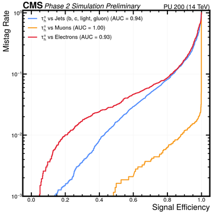</a> | <a href="img/plotters/curve_overlay_errors.png">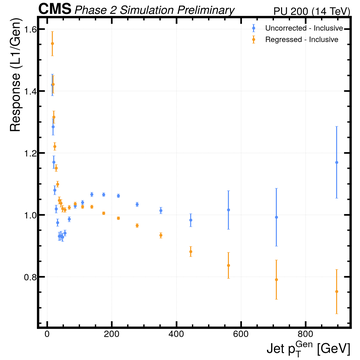</a> | <a href="img/plotters/histogram.png">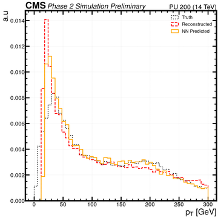</a> | <a href="img/plotters/grid_2d.png">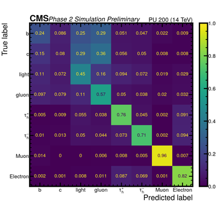</a> |
| tau ROCs, AUC in the labels | pT response vs gen pT | pT spectra | confusion matrix |

| `stacked_bars` | `rate_grid` | `eff_points` | `ratio_map` |
| :---: | :---: | :---: | :---: |
| <a href="img/plotters/stacked_bars.png">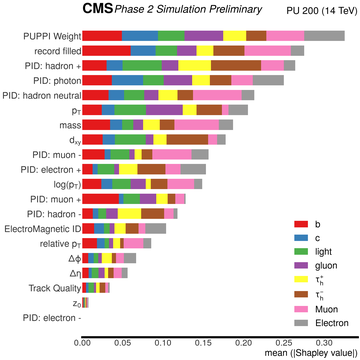</a> | <a href="img/plotters/rate_grid.png">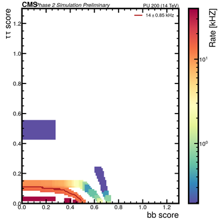</a> | <a href="img/plotters/eff_points.png">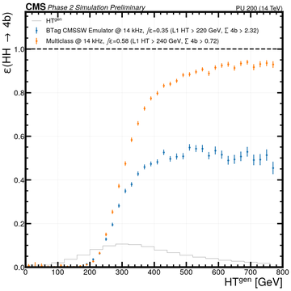</a> | <a href="img/plotters/ratio_map.png">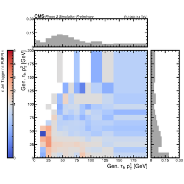</a> |
| SHAP importance per class | bb tau tau rate grid with working point line | HH -> 4b efficiency vs gen HT, model and `cmssw/` | di-tau topology efficiency, model / CMSSW |

| `band_overlay` | `scalar_vs_x` | `loss_history` | `hist_2d` |
| :---: | :---: | :---: | :---: |
| <a href="img/plotters/band_overlay.png">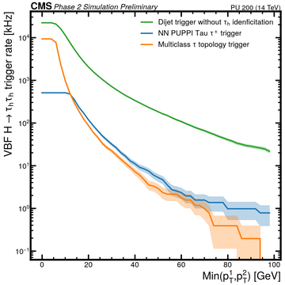</a> | <a href="img/plotters/scalar_vs_x.png">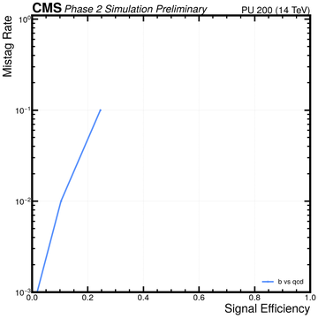</a> | <a href="img/plotters/loss_history.png">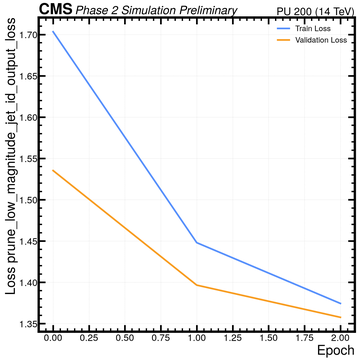</a> | <a href="img/plotters/hist_2d.png">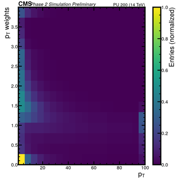</a> |
| di-tau MinBias rate vs pT threshold | b efficiency at the MISTAG_POINTS | loss per epoch (3-epoch test model) | pT weight vs constituent pT (3-epoch weighted-average test model) |

| `mesh_panels` | `pairwise_2d` | `turn_on` | `pt_map` |
| :---: | :---: | :---: | :---: |
| <a href="img/plotters/mesh_panels.png">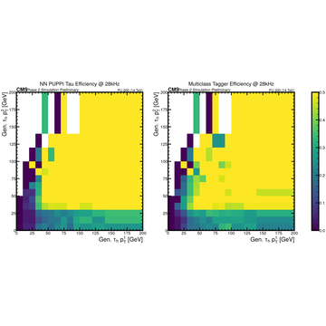</a> | <a href="img/plotters/pairwise_2d.png">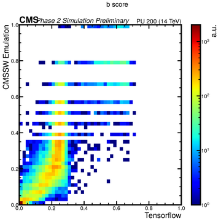</a> | <a href="img/plotters/turn_on.png">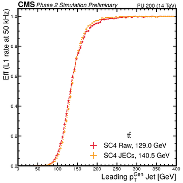</a> | <a href="img/plotters/pt_map.png">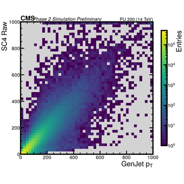</a> |
| di-tau topology efficiency maps, NN and CMSSW | b score per jet, network vs CMSSW emulator | leading jet turn-on at 50 kHz, raw and corrected L1 jets (TT, MinBias) | gen vs L1 pT of the TT jets |

| `mass_peak` | | | |
| :---: | :---: | :---: | :---: |
| <a href="img/plotters/mass_peak.png">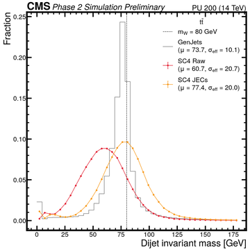</a> |  |  |  |
| W -> q q' dijet mass, gen, raw and corrected L1 jets (TT) | | | |

The two text plotters write a `.txt` file instead of a figure. `text_summary` (here the single tau
efficiencies, `physics/tau/TotalEff_barrel.txt`):

```
Total Tau Eff
SeededCone + pt regression, no ID cut (Multiclass limit) 0.2743
Multiclass NN 0.2246
CMSSW  0.1946
```

`agreement` (`emulation/bit_accuracy.txt`, first lines):

```
Percent bit accuracy between CMSSW emulator and hls4ml for regression: 0.3478 %
Percent bit accuracy between CMSSW emulator and hls4ml for b: 8.6371 %
Percent bit accuracy between CMSSW emulator and hls4ml for charm: 10.0722 %
```

The emulation examples use a local ntuple whose emulator was not built from the baseline model, hence the
low agreement. The `turn_on`, `pt_map` and `mass_peak` examples are drawn by those plotters from the jet
ntuples in `data/` (L1 seeded cone jets as read and corrected, against their gen-matched jets), not from
FastPUPPI files.

## Adding a plot to an existing collection

Write a function that returns the plot's `PlotSpec`, and add its call to the list the collection
returns. The result must be computed by the eval collection the plot collection reads, so add the
expression there first if it is not yet computed. For example, the b score histogram in the
jetClassifier plots:

```python
# 1. tagger/eval/variables/collections.py, inside jetClassifier(config, info): compute it
out.append("scoreHist(b)")
```

```python
# 2. tagger/plot/specs/jet_classifier.py: the plot ...
def b_score():
    """basic/b_score: b score of all jets."""
    return PlotSpec(
        name="basic/b_score",
        plotter="histogram",
        series=[
            Series("scoreHist(b)", label="b score"),
        ],
        options=dict(
            xlabel="b score",
            ylabel="a.u.",
            logy=True,
        ),
    )


# ... and inside jetClassifier(config, info): draw it
plots.append(b_score())
```

Then run the eval collection again before plotting (`python -m tagger.eval -m <model> -c jetClassifier`).

## Adding a plot collection

A function decorated with `@plot_collection`, in a module under `tagger/plot/specs/`. `reads` names
the eval collections it needs; `info` has the model's `classes`, `particle_features`, `losses` and flags such as
`has_eta`. The docstring is required.

```python
from tagger.plot.registry import PlotSpec, Series, plot_collection


def score_hist(cls):
    """scores/<cls>_score: score distribution of one class."""
    return PlotSpec(
        name=f"scores/{cls}_score",
        plotter="histogram",
        series=[
            Series(f"scoreHist({cls})", label=cls),
        ],
        options=dict(
            xlabel=f"{cls} score",
            ylabel="a.u.",
        ),
    )


@plot_collection(reads=["jetClassifier"])
def scores(config, info):
    """Score distribution of every class."""
    return [score_hist(c) for c in info.classes]
```

```
python -m tagger.plot -m output/baseline -c scores
```

## Adding a plotter

Only when no existing plotter fits. A plotter is a function `(spec, models) -> figure`, registered with
`@plotter` in `tagger/plot/plotters.py`:

```python
@plotter
def step_ratio(spec, models):
    """Ratio of the curve field ``y`` of the second series to the first, of each model. Options:
    xlabel, ylabel, logy, xlim, ylim, legend."""
    opts = spec.options
    fig, (ax,) = _figure(opts)                      # figure with the CMS label
    num, den = spec.series
    for im, model in enumerate(models):
        a, b = model.get(num.expr), model.get(den.expr)
        kw = _overlay_style(num.style, im, 0, len(models), 1)
        ax.plot(a["x"], a[num.y] / b[den.y], label=_label(num.label, model, models), **kw)
    _finish(ax, opts)                               # labels, scales, limits, legend
    return fig
```

Rules:
- Read results only through `model.get(expr)` (a curve is a dict of arrays, a scalar a number) and
  `model.scalar(expr)`. Never compute physics in a plotter: if a number is worth plotting, it is a
  variable. Comparing two finished results (a ratio, an agreement) is fine.
- Loop over `models` for overlays, or draw `models[0]` and say so in the docstring.
- Use `_figure`, `_finish`, `_label` and `_overlay_style` so that options, labels and overlays work like
  in the other plotters.
- Return the figure; `tagger.plot` saves it as pdf and png and closes it. Return a string to write a
  text file instead.
- A plotter that compares its series with each other belongs in `COMPARISONS` in
  `tagger/plot/cli.py`, so that it is skipped when one side is missing.
- Document the curve fields and options in the docstring, and add a test in `tests/eval/test_plot.py`.
